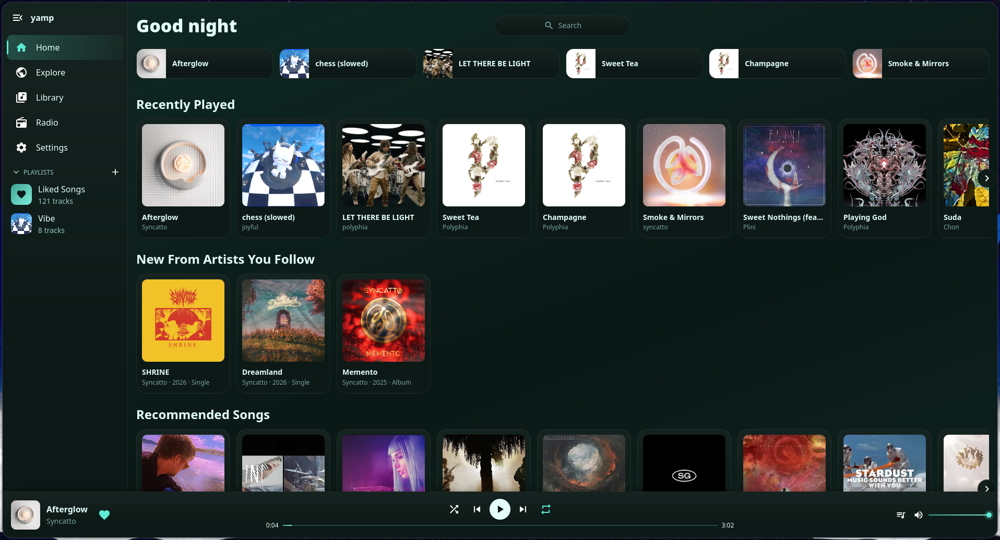
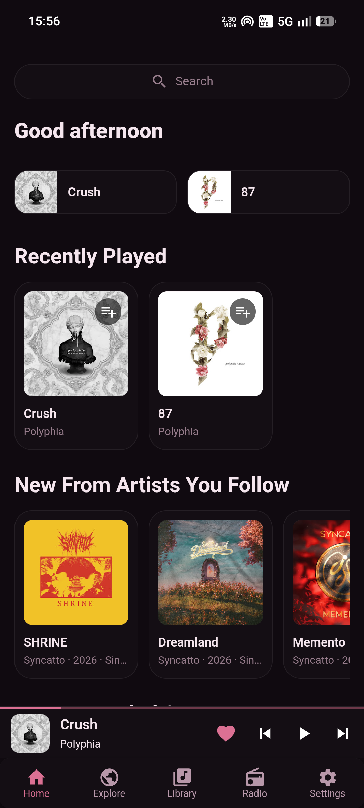
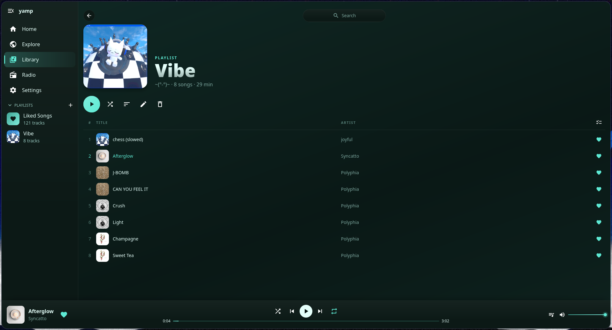
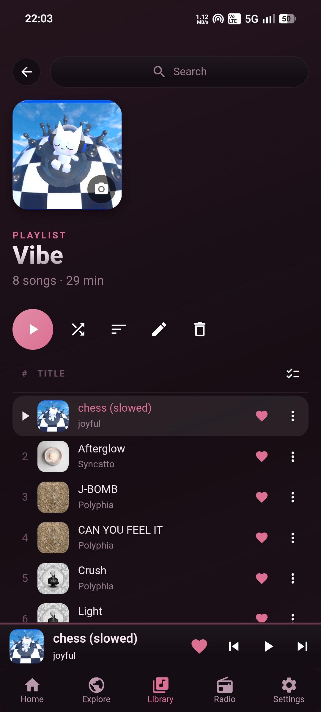
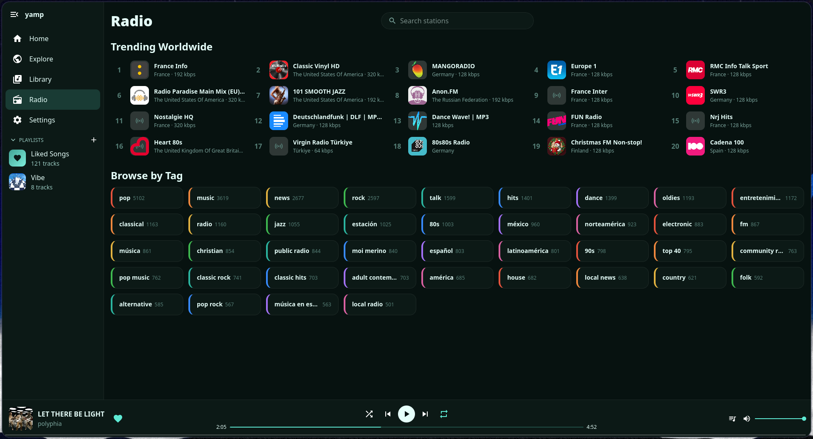
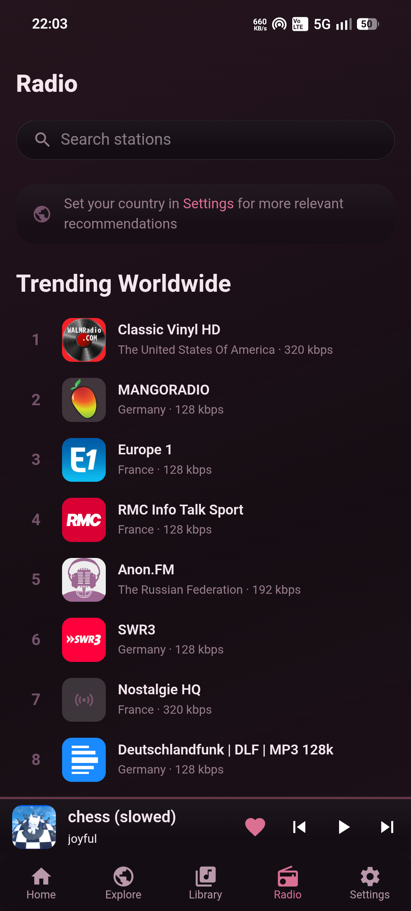

<div align="center" markdown="1">


# Yamp

**Yet Another Music Player**

Stream, download and sync your music on desktop and Android.

[](https://github.com/Julius-IX/yamp/releases/latest)
[](https://github.com/Julius-IX/yamp/blob/main/LICENSE)





[Download](https://github.com/Julius-IX/yamp/releases/latest) | [Features](#features) | [Screenshots](#screenshots) | [Installing](#installing) | [Cloud sync](#cloud-sync) | [Building](#building) | [Terms](https://github.com/Julius-IX/yamp/blob/main/TERMS.md) | [Privacy](https://yamp.cc/PRIVACY)

</div>

---

Yamp is a free music player whose interface follows [Snowify](https://github.com/nyakuoff/Snowify), while the features are tuned to my own needs and taste.
It is a personal project built for educational purposes and it is MIT licensed.
There is no Yamp server and no account to make. Everything runs on your own device and, if you choose to sync, in your own cloud storage.

The official builds are covered by the [Terms of Service](https://github.com/Julius-IX/yamp/blob/main/TERMS.md), which also explain how Yamp relates to the third-party services it uses.
How Yamp handles your data is described in the [Privacy Policy](https://yamp.cc/PRIVACY).
Please read both before using the app.

## Features

| | |
| --- | --- |
| **Streaming** | Search and stream from YouTube and YouTube Music, with artist pages, albums, trending, new releases and moods to browse |
| **Local music** | Play your own music from folders on the device, which are watched for changes |
| **Downloads** | Save songs to listen offline |
| **Library** | Likes, playlists and followed artists, with a queue, autoplay, shuffle and repeat |
| **Videos** | Music videos are treated like any other song, so they can be liked, saved to a playlist and downloaded |
| **Sync** | Keep your library and settings in step across devices through your own Google Drive, OneDrive or iCloud |
| **Selective sync** | Choose per section of the settings what follows you to your other devices |
| **Import and export** | Bring a library over from CSV or JSON, such as the account data of Spotify or an Exportify export, and export your own to CSV |
| **Radio** | Listen to internet radio, found by search or by tag |
| **Themes** | Custom themes with a color for every part of the interface, in both dark and light |
| **Statistics** | Listening statistics that stay on your devices and can be turned off |
| **Discord** | Rich Presence on desktop |
| **System integration** | Media controls from the lock screen or the system, and updates from inside the app |

## Screenshots

<table>
  <tr>
    <th align="center">Desktop</th>
    <th align="center">Android</th>
  </tr>
  <tr>
    <td align="center"><br><sub>Playlist</sub></td>
    <td align="center"><br><sub>Playlist</sub></td>
  </tr>
  <tr>
    <td align="center"><br><sub>Radio</sub></td>
    <td align="center"><br><sub>Radio</sub></td>
  </tr>
</table>

## Installing

Every build is on the [releases page](https://github.com/Julius-IX/yamp/releases/latest). Pick the file for your system and the app takes care of its own updates from there.

| System | File | |
| --- | --- | --- |
| Windows | NSIS setup, `.exe` | [Get it](https://github.com/Julius-IX/yamp/releases/latest) |
| Linux | `.AppImage` | [Get it](https://github.com/Julius-IX/yamp/releases/latest) |
| Android | universal `.apk` | [Get it](https://github.com/Julius-IX/yamp/releases/latest) |

macOS and iOS builds are not distributed.
The macOS app can be built from source, see [Building](#building).
iOS is not supported yet, since there is no music engine for it.

<details markdown="1">
<summary><b>Windows</b></summary>

<br>

The installer is not signed with a paid certificate, so SmartScreen may show a "Windows protected your PC" screen.
Choose **More info** and then **Run anyway** to continue.

</details>

<details markdown="1">
<summary><b>Linux</b></summary>

<br>

Make the AppImage executable and start it:

```sh
chmod +x yamp_*.AppImage
./yamp_*.AppImage
```

Only an AppImage can replace itself, so updates from inside the app work with this build only.

</details>

<details markdown="1">
<summary><b>Android</b></summary>

<br>

The apk does not come from the Play Store, so Android asks for a few permissions first.

1. Open the downloaded file. When asked, allow your browser or file manager to install unknown apps.
2. Play Protect may stop the install with a message that the app is blocked or unrecognized. Choose **More details** and then **Install anyway**.
3. If there is no such option, open the Play Store, tap your profile picture, go to **Play Protect** and its settings, and turn off scanning apps with Play Protect for the moment. Turn it back on once Yamp is installed.

The warning only appears because the app is not distributed through the Play Store.
An update is installed over the existing app and works as long as it comes from the official releases.

</details>

## Cloud sync

Your library lives in a local SQLite database on each device.
When a cloud account is linked, every device writes its changes to its own log in a private folder of that account and applies the logs of the others.
Settings travel along with the library, and the newest change wins.

| Provider | Folder used | Works with |
| --- | --- | --- |
| [Google Drive](https://drive.google.com) | the hidden app data folder | any device |
| [OneDrive](https://onedrive.live.com) | the app folder | any device |
| [iCloud](https://www.icloud.com) | the container of the app | Apple devices only |

Yamp cannot see any other file in your account.
iCloud only exists on Apple platforms, so devices of mixed kinds have to use Google Drive or OneDrive.
The [Privacy Policy](https://yamp.cc/PRIVACY) lists exactly what is stored, and how to disconnect an account and remove the data.

Providers sit behind a small storage interface, see the readme of [`cloud-sync`](https://github.com/Julius-IX/yamp/blob/main/src-tauri/crates/cloud_sync/README.md), so a fork can add one of its own.
A build only offers a service when it was compiled with client ids for it, see [BUILDING.md](https://github.com/Julius-IX/yamp/blob/main/dev/BUILDING.md#cloud-sync).

## Third-party tools

| Tool | Used for |
| --- | --- |
| [yt-dlp](https://github.com/yt-dlp/yt-dlp) | Reading and downloading YouTube content on desktop, fetched from its releases and kept up to date by the app |
| [youtubedl-android](https://github.com/yausername/youtubedl-android) | The same job on Android |
| [Radio Browser](https://www.radio-browser.info) | The directory of radio stations |
| [Discord](https://discord.com) | Rich Presence, through the app running on your computer |

## Tech stack

[Tauri](https://tauri.app) with a Rust backend, and a React frontend in TypeScript using [MUI](https://mui.com) and [Vite](https://vite.dev).
Storage is SQLite through [sqlx](https://github.com/launchbadge/sqlx).

## Building

| Read | For |
| --- | --- |
| [BUILDING.md](https://github.com/Julius-IX/yamp/blob/main/dev/BUILDING.md) | Setup, running, release builds and build time keys |
| [TESTING.md](https://github.com/Julius-IX/yamp/blob/main/dev/TESTING.md) | Which crates to test and how |
| [build.sh](https://github.com/Julius-IX/yamp/blob/main/scripts/build.sh) | Creates the release builds in one go |

Each crate under [`src-tauri/crates`](https://github.com/Julius-IX/yamp/tree/main/src-tauri/crates) has a readme of its own.

## License

Yamp is released under the [MIT License](https://github.com/Julius-IX/yamp/blob/main/LICENSE).
Forks and builds that are not published in the [releases](https://github.com/Julius-IX/yamp/releases) of this repository are not covered by the [Terms of Service](https://github.com/Julius-IX/yamp/blob/main/TERMS.md).
